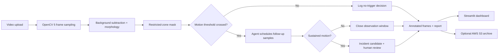

# VisionGuard AI — Agentic Visual Safety Monitoring

**OpenCV AI Competition 2026 prototype** • Python • OpenCV 5 • Streamlit • AWS S3 • Docker/Render

VisionGuard analyzes video for **sustained motion inside a configurable restricted-zone region**. Its small agent loop uses initial visual evidence to decide whether to inspect additional sampled frames, then records an incident candidate for human review. The dashboard provides annotated frames, an event timeline, a JSON report, CSV export, and optional S3 report archiving.

> **Honest scope:** this baseline is motion-based. It does not identify people, recognize PPE, infer intent, or prove a safety violation. The default zone is a demonstration region in the lower-right of the frame; adapt it to the camera scene and validate against labeled footage before making real-world claims. Alerts require human review.

## Run locally

Requires Python 3.12 and a platform with an OpenCV 5 wheel.

```bash
python -m venv .venv
# macOS/Linux
source .venv/bin/activate
# Windows PowerShell: .venv\Scripts\Activate.ps1
python -m pip install --upgrade pip
pip install -r requirements.txt
streamlit run app.py
```

Use **Create and analyze a demo video** first, or upload an MP4/MOV/AVI clip. If dependency resolution fails on your platform, confirm `pip index versions opencv-python-headless` and install a supported OpenCV 5 wheel; do not silently downgrade to OpenCV 4 for competition submission.

## How the agent loop works

1. **Perceive:** OpenCV decodes sampled frames, applies MOG2 background subtraction, morphology, contour filtering, and a region-of-interest mask.
2. **Plan:** when zone motion crosses a threshold, the agent chooses a follow-up verification step instead of immediately declaring a confirmed incident.
3. **Verify:** later sampled frames are inspected for sustained zone motion.
4. **Act:** if the configured persistence threshold is met, the app records a `CONFIRMED_MOTION` incident candidate and explicitly requires human review. When motion stops, it closes the event window.
5. **Audit:** the app exposes a trace of perception/decision/action steps and allows a report download.

This is a deliberately transparent, rule-based agent workflow; it is not a general-purpose LLM agent.

## AWS S3 evidence archive

The app's **Archive report to AWS S3** button uploads the JSON report to an S3 bucket with server-side encryption requested. This is the cloud component for the prototype. Create a bucket in a region you control and grant the runtime identity only the necessary `s3:PutObject` permission for the intended prefix. Prefer an IAM role (for example, when hosted in AWS) instead of static keys.

Environment variables:

- `AWS_REGION` (example: `ap-south-1`)
- `S3_BUCKET` (your bucket name)
- For local use only, configure AWS credentials with the AWS CLI or your local credential provider. **Never commit credentials to GitHub.**

Render's hosted environment does not automatically inherit your personal AWS IAM role. If deploying on Render, configure a least-privilege IAM user/access key as secret environment variables only if required by your AWS setup; rotate them after the competition. Never paste keys into source code or commit history.

## Deploy on Render with Docker

1. Push this folder to a GitHub repository.
2. In Render, choose **New → Web Service**, connect the repo, and choose Docker/runtime from the repository's `Dockerfile` (or use the included `render.yaml` Blueprint).
3. Wait for build and health check. Streamlit listens on Render's `$PORT`.
4. For S3 archiving, set `AWS_REGION` and `S3_BUCKET` in the Render service environment. Add credentials only through Render's secret environment settings if necessary.
5. Test with the synthetic demo and a small consented sample video. Save the live URL and screenshots for your submission.

Deployment is configured but not performed by this ZIP. A public URL only exists after you connect the repo and Render completes a successful deploy.

## Tests

```bash
pytest -q
```

The test creates a synthetic clip and checks that the analysis pipeline returns a summary and agent trace. It also verifies that the runtime has OpenCV 5. Run it in the same environment used for deployment.

## Competition submission checklist

- [ ] Verify the installed `cv2.__version__` is `5.x` on the actual runtime.
- [ ] Capture a real run using permissioned test footage; don't submit only a synthetic demo.
- [ ] Record test data, thresholds, successful cases, false positives, and failure cases.
- [ ] Adjust the region-of-interest to your camera and document how it was selected.
- [ ] Test the S3 upload using your own bucket and least-privilege permissions.
- [ ] Deploy and verify the public endpoint, or prepare a live screen-share fallback.
- [ ] Add an architecture diagram and technical report, team details, and a <=5-minute judge-accessible demo video.
- [ ] Clearly label the prototype's limitations and human-review requirement.

## Architecture



## Suggested evaluation table

Evaluate on consented clips labeled by a human reviewer. Record at least: clip count, total duration, true alerts, false alerts, missed events, processing time, and limitations. Do not invent metrics or report results before running the tests.

## Repository contents

- `app.py` — Streamlit user interface and report downloads
- `src/vision.py` — OpenCV processing and evidence-driven agent loop
- `src/storage.py` — optional S3 upload
- `tests/test_vision.py` — smoke test
- `Dockerfile`, `render.yaml` — deployment configuration
- `docs/TECHNICAL_REPORT.md`, `docs/ARCHITECTURE.md` — submission documentation
