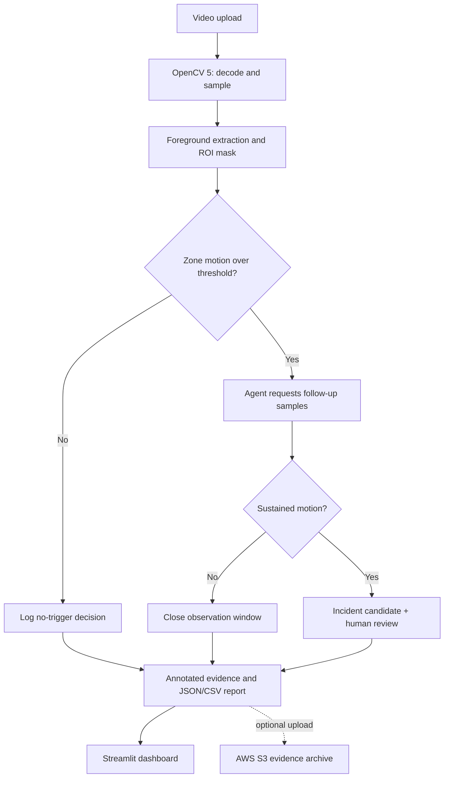

# Architecture

## Trust boundaries

- Uploaded video is untrusted input; only process supported video formats and avoid unnecessary retention.
- AWS credentials must be provided through a secret manager/environment, never source control.
- S3 permissions should be limited to writing the designated report prefix.
- Alerts are suggestions for human review, not verified safety findings.
